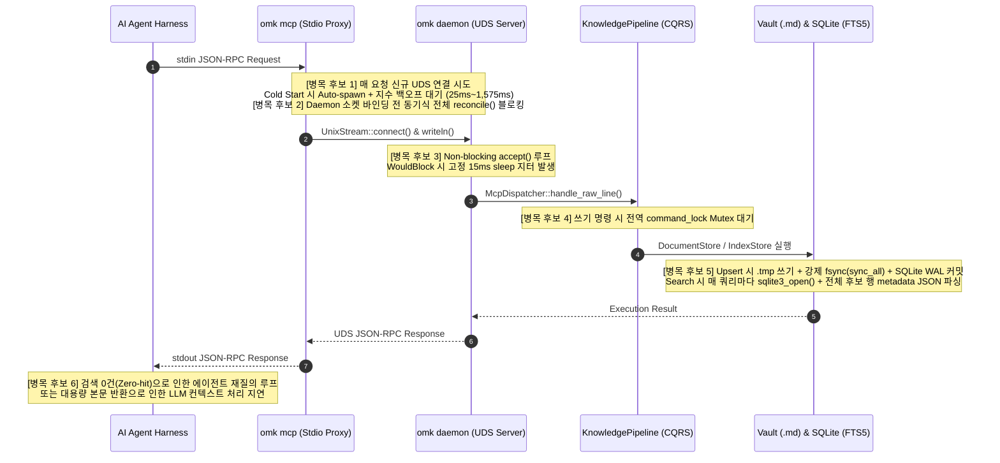

# EPIC-OBS-01: 프라이버시 보호 기반 실행 관측성 및 성능 진단 체계 (Privacy-Preserving Execution Observability & Performance Diagnostics)

## 1. Introduction
### 1.1 Purpose
본 스펙은 AI 채팅 세션에서 `omk`를 이용해 지식을 축적(`upsert_knowledge`)하거나 탐색/인출(`search_knowledge`, `read_knowledge`)할 때 발생하는 체감 응답 지연(Latency)의 원인을 정량적 데이터로 규명하고, 데이터를 근거로 시스템을 지속적으로 개선하기 위한 **실행 관측성(Observability) 및 성능 진단 기반**을 정의합니다. 특히 로컬 지식 금고(Local Vault)의 특성상 개인정보(PII)와 민감한 지식 원문이 로그나 메트릭을 통해 유출되지 않도록 **설계 단계부터의 프라이버시 보호(Privacy-by-Design)** 원칙을 엄격히 강제합니다.

### 1.2 Scope
- 현행 코드베이스(`proxy`, `daemon`, `protocol`, `search`, `vault`, `index`)의 지연 발생 후보 구간 및 로깅 한계 진단.
- 프록시(`omk mcp`), 데몬(`omk daemon`), 코어 CQRS 파이프라인(`omk_core`) 전 구간에 걸친 End-to-End Trace & Span 지연 시간 계측 모델 정의.
- AI 에이전트의 도구 활용 효율성 및 검색 품질 정량 지표(Zero-Hit 비율, 재질의 빈도, 페이로드 및 추정 토큰 크기 등) 정의.
- 민감 정보(문서 본문, 제목, 검색어, 작성자, URI, OS 계정 경로 등)의 로그 노출을 원천 차단하는 마스킹/익명화(Redaction & Local Salted Hashing) 정책 및 100% 로컬 격리 저장 원칙 명세.
- 구조화 로그/텔레메트리 파일의 무한 비대화를 방지하기 위한 로그 로테이션 및 보존(Log Rotation & Retention) 정책 정의.
- 인간 개발자와 에이전트가 병목 지점(P50/P95/P99/Max 지연 시간, 구간별 병목 비중, 콜드 스타트 횟수, 최근 느린 요청 요약)을 즉시 진단할 수 있는 `omk stats` CLI 인터페이스 정의.

### 1.3 Definitions, Acronyms, and Abbreviations
- **End-to-End Latency (종단간 지연 시간):** AI 에이전트 하네스가 `omk mcp`의 `stdin`으로 JSON-RPC 요청 프레임을 전달한 시점부터 `stdout`으로 응답 프레임이 플러시(Flush)될 때까지 소요된 총 시간.
- **Span (실행 구간):** 단일 요청 처리 과정 내부의 세부 작업 단위(예: 소켓 연결, 락 대기, 마크다운 `fsync`, SQLite FTS5 쿼리 등) 및 그 소요 시간(`_us`, 마이크로초).
- **Cold Start (콜드 스타트):** 백그라운드 `omk daemon`이 실행 중이지 않아 `omk mcp` 프록시가 데몬을 자동 기동(`auto_spawn`)하고 초기 대사(`reconcile`) 및 소켓 바인딩이 완료될 때까지 지수적 백오프로 대기하는 현상.
- **Zero-Hit Rate (무매칭 비율):** `search_knowledge` 호출 중 반환된 매칭 결과 수(`result_count`)가 `0`건인 요청의 비율로, 에이전트의 검색 실패 및 재시도 루프(Retry Churn)를 나타내는 핵심 지표.
- **Local Salted Hash (로컬 솔트 단방향 해시):** 원문(문서 ID, 검색 질의어 등)을 노출하지 않으면서도 동일 대상에 대한 반복 접근 상관관계를 분석하기 위해 로컬 전용 난수 시드(Salt)를 결합하여 생성한 비가역 해시 식별자.
- 기타 핵심 도메인 용어(`omk CLI`, `omk Skill`, `Local Vault` 등)는 [용어 사전 (Glossary)](../glossary.md)을 따릅니다.

### 1.4 References
- [`CONSTITUTION.md`](../../../CONSTITUTION.md) : Environment Isolation(환경 독립성), Core Isolation(코어 격리), Zero Heavy Dependencies(외부 의존성 최소화) 원칙
- [`docs/architecture.md`](../../architecture.md) : Daemon & Proxy 통신 구조 및 CQRS AI Memory Pipeline 아키텍처
- [`docs/requirements/glossary.md`](../glossary.md) : 프로젝트 용어 사전 및 도메인 경계
- [`docs/requirements/features/EPIC-IPC-01.md`](EPIC-IPC-01.md) : MCP 통신 프로토콜 및 데몬/프록시 생명주기
- [`docs/requirements/features/EPIC-CLI-01.md`](EPIC-CLI-01.md) : 인간 친화적 CLI 사용성 및 `omk status` 명세
- [`docs/requirements/features/EPIC-SEARCH-01.md`](EPIC-SEARCH-01.md) : 지식 검색 및 SQLite FTS5 인덱싱 명세

---

## 2. Overall Description

### 2.1 Current Latency Bottleneck & Observability Defect Analysis (현행 지연 후보 구간 및 관측성 결함 진단)
현재 코드베이스(`skill/src/proxy/mod.rs`, `skill/src/daemon/mod.rs`, `skill/src/protocol/mod.rs`, `core/src/search/mod.rs`, `core/src/vault/mod.rs`, `core/src/index/mod.rs`)를 정밀 분석한 결과, 실제 AI 채팅 세션에서 `omk` 호출 시 지연을 유발할 수 있는 **6대 구조적 지연 후보 구간**과 이를 파악하지 못하게 만드는 **2대 로깅/프라이버시 한계**가 확인되었습니다.

| 진단 ID | 계층 및 대상 코드 위치 | 지연 발생 메커니즘 및 현행 관측성 한계 | 해결 요구사항 |
| :--- | :--- | :--- | :--- |
| **`DEF-OBS-01`** | **Proxy 구간** `skill/src/proxy/mod.rs` (`forward_line`, `connect_with_backoff`) | **매 요청 소켓 재연결 및 Cold Start 백오프 블로킹 미계측:** `forward_line`이 호출될 때마다 매번 `connect_with_backoff()`로 신규 소켓 연결을 맺음. 데몬 미구동 시 `spawn_background_daemon()` 호출 후 `25ms → 50ms → 100ms → 200ms → 400ms → 800ms`(최대 6회, 합산 `1,575ms`) 슬립 대기를 수행하나, 프록시 측 로깅이 전무하여 콜드 스타트 발생 여부와 연결 대기 시간을 전혀 알 수 없음. | `REQ-OBS-001` |
| **`DEF-OBS-02`** | **Daemon 기동 구간** `skill/src/daemon/mod.rs` (`DaemonServer::initialize`, `run_blocking`) | **소켓 바인딩 전 동기식 전체 `reconcile()` 수행:** `DaemonServer::initialize()`가 `PidLockGuard::acquire()` 및 `UnixListener::bind()` **이전에** `pipeline.reconcile()`을 동기 실행하여 Vault의 모든 `.md` 파일을 읽고 파싱함. 문서 수가 증가하면 소켓 생성이 늦어져 프록시의 백오프 지연이 길어지거나 다중 프록시가 중복 데몬 스폰을 시도하게 되며, `reconcile` 소요 시간이 기록되지 않음. | `REQ-OBS-001` |
| **`DEF-OBS-03`** | **Daemon 수신 구간** `skill/src/daemon/mod.rs` (`run_blocking`) | **Non-blocking Accept 폴링 슬립 지터(Jitter):** `listener.accept()`가 `WouldBlock`을 반환할 때마다 고정 `15ms` (`thread::sleep(Duration::from_millis(15))`), 에러 시 `50ms`를 대기함. 매 요청이 새로운 소켓 연결을 맺는 구조(`DEF-OBS-01`)와 결합되어 모든 단일 요청마다 평균 `7.5ms`~최대 `15ms`의 불필요한 스케줄링 지연이 누적됨. | `REQ-OBS-001` |
| **`DEF-OBS-04`** | **CQRS 디스패처 구간** `skill/src/protocol/mod.rs` (`McpDispatcher::handle_raw_line`) | **전역 Command Lock 경합 대기 시간 불투명:** 쓰기 요청(`upsert_knowledge`, `reconcile`)이 단일 `command_lock: Mutex<()>`과 `SqliteFtsIndexStore::writer: Mutex<SqliteConnection>`을 순차 획득함. 선행 쓰기나 대사 작업이 길어질 때 후속 요청이 락에서 얼마나 대기(`lock_wait_us`)했는지 전혀 계측되지 않음. | `REQ-OBS-001` |
| **`DEF-OBS-05`** | **Core Storage/Index 구간** `core/src/vault/mod.rs` `core/src/index/mod.rs` | **디스크 `fsync` 및 매 조회 SQLite 재연결/JSON 파싱 비용 불투명:** 1) `put_document()`는 기존 문서 읽기 후 `.tmp` 파일 생성 + `file.sync_all()`(`fsync`) + `rename`을 수행하고 직후 SQLite `IMMEDIATE` 트랜잭션 커밋을 수행함. 2) `search()`는 호출될 때마다 `open_reader()`로 매번 `sqlite3_open()` 및 `PRAGMA` 실행을 반복하며, `collect_filtered_rows()`에서 `limit * 4`개 후보 행마다 `metadata` JSON 문자열을 파싱함. 이 세부 구간들(`vault_write_us`, `fsync_us`, `db_open_us`, `fts_query_us`, `filter_post_us`)의 소요 시간을 분리 확인할 수 없음. | `REQ-OBS-001` |
| **`DEF-OBS-06`** | **AI Agent 상호작용 구간** `skill/src/protocol/mod.rs` `core/src/index/mod.rs` | **에이전트 재질의(Retry Churn) 및 컨텍스트 비대화 판별 불가:** AI 채팅 세션이 느린 원인이 `omk` 실행 시간 때문인지, 아니면 `build_fts_query()`의 기본 `AND` 결합으로 인해 검색 결과 `0`건(Zero-hit)이 반환되어 LLM이 여러 번 검색 도구를 재호출하거나, `read_knowledge`가 거대한 마크다운 본문을 반환해 LLM 토큰 추론 시간이 길어진 것인지 구분할 정량 지표가 없음. | `REQ-OBS-002` `REQ-OBS-005` |
| **`DEF-OBS-07`** | **현행 로거의 구조적 한계** `skill/src/daemon/mod.rs` (`write_structured_log`) | **초 단위 해상도 한계, RPC 미기록 및 무제한 파일 증가:** 1) `KnowledgeEntity::current_timestamps()`가 **1초(`s`) 단위** 해상도만 제공하여 밀리초(`ms`)/마이크로초(`us`) 단위의 성능 계측이 불가능함. 2) 데몬 기동/종료 외에 개별 도구 호출(`upsert`, `search`, `read`)은 전혀 로깅되지 않음. 3) 매 로그 출력마다 `OpenOptions::open()`을 호출하며, 파일 크기 제한(Log Rotation)이 없어 장기 실행 시 디스크 공간 고갈 위험이 있음. | `REQ-OBS-001` `REQ-OBS-004` |
| **`DEF-OBS-08`** | **개인정보 및 민감 지식 보호** 전 계층 (`proxy`, `daemon`, `core`) | **PII 및 민감 지식 원문 노출 위험:** 관측성을 위해 요청/응답이나 에러 상세를 그대로 로깅할 경우 사용자의 비공개 지식 본문(`content`), 제목(`title`), 검색어(`query`), 작성자 이메일(`author`), 사내 URI, OS 홈 디렉터리 사용자명(`/Users/<username>`)이 평문으로 노출될 위험이 있음. | `REQ-OBS-003` |

### 2.2 User Classes and Characteristics
- **Human Developer / System Maintainer (인간 개발자 및 운영자):** `omk stats` 명령어와 구조화된 로컬 텔레메트리를 통해 실제 AI 채팅 세션 이후 어느 구간(Cold Start, Lock, Disk `fsync`, SQLite FTS5, 에이전트 Zero-hit 재시도 등)에서 시간이 소요되었는지 즉시 확인하고 코드나 스킬 프롬프트(`SKILL.md`)를 개선하는 주체.
- **AI Agent (자율 진단 주체):** 필요 시 `omk stats --json` 또는 `omk status`를 통해 로컬 금고의 응답 건강도와 검색 적중률을 확인하되, 원문 노출 없는 안전한 요약 통계만 소비하는 주체.

### 2.3 Design and Implementation Constraints
- **Zero Heavy External Dependencies (`CONSTITUTION.md` §2):** OpenTelemetry, Prometheus, `tracing`, `log`, `serde` 등 외부 크레이트를 추가하지 않고, Rust 표준 라이브러리(`std::time::Instant`, `std::time::SystemTime`, `std::fs`)와 `omk_core` 내장 JSON 파서/직렬화기(`JsonValue`)만으로 계측, 해싱, 로테이션, 통계 집계를 구현해야 한다.
- **Core Isolation (`CONSTITUTION.md` §1):** `omk_core`는 파일 시스템 로그 경로나 데몬 상태에 직접 의존하지 않으며, 순수 도메인/계측 구조체(`PipelineTimings`, `OperationMetrics` 등)를 반환하여 단위 테스트의 순수성을 유지해야 한다.
- **100% Local Environment Isolation (`CONSTITUTION.md` §1):** 모든 관측 데이터는 로컬 `<vault_dir>/.omk/` 디렉터리 내부에만 저장되며, 외부 네트워크로 텔레메트리를 전송하는 기능은 일절 포함하지 않는다(Zero External Telemetry).

---

## 3. System Features

### 3.1 REQ-OBS-001: End-to-End 실행 구간별 지연(Latency Breakdown) 계측 모델
- **3.1.1 Description and Priority:** 매우 높은 우선순위 (핵심 관측 인프라). 단조 시계(`std::time::Instant`)를 사용하여 마이크로초(`us`) 정밀도로 프록시, 데몬, 코어 파이프라인의 전 구간 소요 시간을 분리 계측합니다.
- **3.1.2 Stimulus/Response Sequences:**
  - *Stimulus:* AI 에이전트가 `omk mcp`를 통해 MCP 요청(`tools/call` 등)을 전송하거나 데몬이 기동/대사(`reconcile`)를 수행함.
  - *Response:* 각 계층은 단조 시계(`Instant::now()`)로 하위 Span의 소요 시간을 마이크로초(`u64`) 단위로 측정하고, 요청 완료 시 단일 구조화 텔레메트리 레코드로 집계하여 기록함.
- **3.1.3 Functional Requirements:**
  - 시간차(Duration) 계측은 시스템 시계 역행의 영향을 받지 않도록 반드시 `std::time::Instant`를 사용하여 마이크로초(`us`) 단위로 측정해야 하며, 이벤트 발생 시각 타임스탬프는 밀리초(`ms`) 정밀도(`timestamp_ms` 및 `YYYY-MM-DDTHH:MM:SS.mmmZ`)를 가져야 한다.
  - 시스템은 각 요청 또는 생명주기 이벤트에 대해 고유한 요청 추적 식별자(`trace_id`, 64-bit hex)를 부여하고 다음 **3대 계층별 세부 Span 타이밍**을 계측해야 한다:

| 계층 (Layer) | 대상 동작 / 메서드 | 필수 계측 Span 및 메트릭 필드 | 설명 |
| :--- | :--- | :--- | :--- |
| **1. Proxy Layer** (`omk mcp`) | 모든 포워딩 요청 | `proxy_connect_us` `cold_start` (`bool`) `connect_retries` (`u32`) `backoff_wait_us` `ipc_roundtrip_us` `proxy_total_us` | UDS 소켓 연결 소요 시간, 데몬 미구동으로 인한 `auto_spawn` 실행 여부, 백오프 재시도 횟수 및 슬립 대기 시간, 데몬 소켓 송수신 왕복 시간, 프록시 전체 처리 시간 (프록시가 요청 메타데이터 또는 경량 헤더/후속 보고를 통해 전달하거나 로컬 텔레메트리에 기록) |
| **2. Daemon Layer** (`omk daemon`, `McpDispatcher`) | 데몬 기동 및 모든 RPC 요청 | `startup_reconcile_us` `in_flight` (`usize`) `rpc_parse_us` `lock_wait_us` `daemon_total_us` | 기동 시 초기 `reconcile` 소요 시간, 요청 진입 시점의 동시 처리 중 요청 수, JSON-RPC 파싱 시간, 쓰기 명령 시 `command_lock` 획득 대기 시간, 데몬 내 총 실행 시간 |
| **3. Core Pipeline** (`upsert_knowledge`) | 지식 생성/갱신 (Command) | `validate_read_us` `vault_write_us` `vault_fsync_us` `index_write_us` | ID 정규화 + 기존 문서 조회 + 권위(`Authority`) 검증 시간, 마크다운 직렬화 및 임시 파일(`.tmp`) 쓰기/교체(`rename`) 시간, 디스크 강제 동기화(`sync_all`) 시간, SQLite 인덱스 트랜잭션(`knowledge_index` + `knowledge_fts`) 갱신 시간 |
| **3. Core Pipeline** (`search_knowledge`) | 지식 전문/필터 검색 (Query) | `fts_build_us` `db_open_us` `fts_query_us` `filter_post_us` | 검색어 FTS5 쿼리 변환 시간, SQLite Reader 연결 및 PRAGMA 설정 시간, SQLite `prepare` + 첫/전체 `step` 실행 시간, 메타데이터 JSON 파싱 및 필터링/스니펫 합성 시간 |
| **3. Core Pipeline** (`read_knowledge`) | 단건 원문 조회 (Query) | `vault_read_us` `markdown_parse_us` | 디스크에서 `.md` 파일을 읽어오는 I/O 시간, YAML Frontmatter 및 본문을 파싱하는 시간 |
| **3. Core Pipeline** (`reconcile`) | 정합성 대사 및 복구 | `vault_scan_us` `index_hash_scan_us` `reindex_write_us` `orphan_prune_us` | Vault 디렉터리 전체 `.md` 스캔/파싱 시간, SQLite 인덱스 해시 목록 조회 시간, 불일치 문서 재인덱싱 시간, 고아 인덱스 삭제 시간 |

### 3.2 REQ-OBS-002: 에이전트 활용 효율성 및 검색 품질 정량 지표 수집
- **3.2.1 Description and Priority:** 높은 우선순위. AI 채팅 세션의 지연 원인이 `omk` 시스템 병목인지, 에이전트의 비효율적 도구 호출(Zero-hit 반복 검색, 과도한 컨텍스트 조회 등)인지 데이터로 판별하기 위한 비민감 정량 지표를 정의합니다.
- **3.2.2 Stimulus/Response Sequences:**
  - *Stimulus:* 에이전트가 `upsert_knowledge`, `search_knowledge`, `read_knowledge`를 호출함.
  - *Response:* 디스패처와 파이프라인은 원문 텍스트를 제외하고 입출력 크기, 검색 조건 구조, 매칭 결과 수, 에러 코드를 추출하여 텔레메트리 레코드의 `metrics` 객체에 기록함.
- **3.2.3 Functional Requirements:**
  - 모든 RPC 요청 완료 레코드(`event: "rpc_completed"`)에는 다음 공통 분류 및 크기 지표가 포함되어야 한다:
    1. **호출 메타데이터:** `rpc_method` (예: `"tools/call"`, `"ping"`), `tool_name` (해당 시 `"upsert_knowledge"`, `"search_knowledge"`, `"read_knowledge"`, `"reconcile"`), `is_write` (`bool`), `status` (`"ok"` 또는 `"error"`), `error_code` (성공 시 `null`, 실패 시 `-32700` ~ `-32004`).
    2. **페이로드 및 LLM 컨텍스트 부하 지표:**
       - `req_bytes` (`usize`): 수신된 JSON-RPC 요청 프레임의 바이트 길이.
       - `resp_bytes` (`usize`): 반환된 JSON-RPC 응답 프레임의 바이트 길이.
       - `content_bytes` (`usize`) 및 `estimated_tokens` (`usize`, UTF-8 문자 수 또는 바이트 기반 `ceil(bytes / 4)` 추정치): 에이전트가 저장하거나 읽어들인 지식 본문/스니펫의 총량 (LLM 프롬프트 적재 부하 측정용).
  - 도구별 특화 품질 지표는 다음과 같이 수집되어야 한다:
    - **`search_knowledge` 지표:**
      - `query_present` (`bool`): 검색어(`query`) 입력 여부.
      - `query_token_count` (`usize`): 공백 기준 검색 키워드 토큰 개수.
      - `query_has_boolean_op` (`bool`): 명시적 `AND` 또는 `OR` 연산자 사용 여부.
      - `filter_tag_count` (`usize`), `has_source_class_filter` (`bool`), `has_source_type_filter` (`bool`), `has_min_authority_filter` (`bool`): 필터 활용 패턴.
      - `requested_limit` (`u32`), `result_count` (`usize`), `zero_hit` (`bool`, `result_count == 0` 여부): 검색 적중률 및 무매칭 비율 산출 근거.
    - **`upsert_knowledge` 지표:**
      - `upsert_status` (`"created"` 또는 `"updated"`), `source_class` (`USER_EXPLICIT` 등 Enum 값), `source_type` (`WIKI` 등 Enum 값), `sync_strategy` (`UPSERT_FULL` 등 Enum 값), `tag_count` (`usize`).
    - **`read_knowledge` 지표:**
      - `found` (`bool`), `tag_count` (`usize`), `source_class`, `source_type`.

### 3.3 REQ-OBS-003: 개인정보 및 민감 지식 보호 (Privacy-by-Design & Zero-PII Policy)
- **3.3.1 Description and Priority:** 매우 높은 우선순위 (보안 및 프라이버시 헌법적 제약). 관측성 데이터가 사용자의 개인정보(PII)나 비공개 지식 원문을 유출하는 제2의 취약점이 되지 않도록 원천 차단 규칙을 정의합니다.
- **3.3.2 Stimulus/Response Sequences:**
  - *Stimulus 1:* 에이전트가 기밀 아키텍처 문서나 개인정보(이메일, 실명, 토큰 등)가 포함된 내용으로 `upsert_knowledge` 또는 `search_knowledge`를 호출함.
  - *Response 1:* 텔레메트리 로거는 원문 필드(`content`, `title`, `query`, `author`, `uri`, `tags`, `id`)를 절대 파일에 기록하지 않으며, 오직 바이트/토큰 길이, Enum 분류값, 로컬 솔트 해시(`doc_ref`, `query_ref`)만 기록함.
  - *Stimulus 2:* 시스템 경로가 포함된 로그(예: 소켓 경로, Vault 경로, 에러 메시지)가 기록됨.
  - *Response 2:* 사용자 홈 디렉터리 경로(`/Users/<username>` 또는 `/home/<username>`) 및 Vault 루트 경로는 `<HOME>` 또는 `<VAULT>` 플레이스홀더로 치환(Sanitization)되어 OS 계정명이 노출되지 않음.
- **3.3.3 Functional Requirements:**
  - **절대 기록 금지 항목 (Strict Redaction List):**
    - 기본 운영 모드에서 다음 필드의 원문 문자열은 로그 파일(`daemon.log`) 및 통계 출력에 **절대 기록되어서는 안 된다**:
      1. 지식 본문 (`content`) 및 검색 결과 스니펫 (`snippet`)
      2. 지식 제목 (`title`)
      3. 검색 질의어 원문 (`query`) 및 개별 태그 문자열 (`tags`)
      4. 작성자 (`author`), 외부 URI (`source.uri`), 외부 문서 식별자 (`source.external_id`)
      5. 문서 ID 원문 (`id` — 제목 기반으로 생성되므로 민감 단어를 포함할 수 있음)
      6. OS 사용자 계정명이 포함된 파일 시스템 절대 경로
  - **로컬 솔트 기반 익명 상관관계 해시 (Local Salted One-Way Hashing):**
    - 원문을 기록하지 않으면서도 *"동일한 검색어가 반복 실패하는가?"* 또는 *"특정 문서에서 병목이 집중되는가?"*를 분석하기 위해, 데몬은 `<vault_dir>/.omk/telemetry.salt` 파일(생성 시 파일 권한 `0600`)에 로컬 무작위 64-bit 솔트(Salt)를 생성/유지해야 한다.
    - 문서 식별자(`id`)와 정규화된 검색어(`query`)는 해당 로컬 솔트를 결합한 단방향 해시 축약형(예: `doc_ref: "doc#a1b2c3d4e5f60718"`, `query_ref: "qry#9f8e7d6c5b4a3210"`)으로만 기록해야 한다.
  - **에러 메시지 내 민감 값 마스킹 (Error Sanitization):**
    - 요청 처리 중 에러(`InvalidParams`, `NotFound`, `AuthorityViolation`, `AccessDenied` 등)가 발생하여 로그를 남길 때, 사용자가 입력한 파라미터 값이나 문서 ID 원문이 로그 문자열에 포함되지 않도록 표준 에러 코드(`error_code`)와 정제된 에러 유형(`error_kind`)만 기록해야 한다.
  - **100% 로컬 저장 및 명시적 Opt-in 디버그 분리:**
    - 모든 로그 및 메트릭 데이터는 `<vault_dir>/.omk/` 하위 파일에만 저장되며 외부 네트워크 전송 기능은 존재하지 않는다.
    - 로컬 개발자가 디버깅을 위해 명시적으로 환경 변수 `OMK_OBS_UNREDACTED=1`을 설정한 경우에만 제한적으로 문서 `id` 표기를 허용할 수 있으나, 이 경우에도 본문(`content`) 전체 로깅은 금지하며 데몬 시작 로그에 `"WARN: unredacted observability mode enabled"` 경고를 기록해야 한다.

### 3.4 REQ-OBS-004: 구조화 텔레메트리 저장소 및 로그 로테이션 (Log Rotation & Retention Policy)
- **3.4.1 Description and Priority:** 높은 우선순위. 관측성 로그가 디스크 공간을 무한정 소비하지 않도록 용량 상한을 강제하고, 로깅 I/O가 파이프라인 성능을 저하시키지 않도록 보장합니다.
- **3.4.2 Stimulus/Response Sequences:**
  - *Stimulus:* 데몬이 장기 실행되며 `<vault_dir>/.omk/daemon.log` 파일 크기가 설정된 임계치(기본 10MB)에 도달함.
  - *Response:* 로거는 즉시 기존 파일을 `daemon.log.1`로 회전(Rotate)시키고(최대 `N`개 백업 유지, 초과분 삭제), 새로운 `daemon.log` 파일을 생성하여 기록을 이어감.
- **3.4.3 Functional Requirements:**
  - **단일 라인 JSONL 규격 (Structured JSON Lines):**
    - `<vault_dir>/.omk/daemon.log`의 모든 라인은 유효한 단일 JSON 객체여야 하며, `omk_core::domain::JsonValue` 파서로 즉시 역직렬화 가능해야 한다.
    - 각 레코드는 `timestamp` (ISO-8601 밀리초 포함), `timestamp_ms` (Unix epoch ms), `level` (`INFO`, `WARN`, `ERROR`), `event` (`daemon_started`, `daemon_reconcile_completed`, `rpc_completed`, `backpressure_rejected`, `daemon_stopped`), `trace_id`, 그리고 이벤트별 `timings_us` 및 `metrics` 하위 객체를 포함해야 한다.
  - **용량 기반 자동 로테이션 (Size-Bounded Rotation & Retention):**
    - 단일 로그 파일의 기본 최대 크기는 **10 MB** (`10,485,760` bytes)로 제한해야 한다.
    - 보관할 로테이션 백업 파일 수는 기본 **3개** (`daemon.log.1`, `daemon.log.2`, `daemon.log.3`)로 제한하여, 관측성 로그가 차지하는 총 디스크 용량이 어떠한 경우에도 **40 MB**를 초과하지 않도록 보장해야 한다.
    - 로테이션 시: `daemon.log.3` 삭제 → `daemon.log.2`를 `daemon.log.3`으로 변경 → `daemon.log.1`을 `daemon.log.2`로 변경 → `daemon.log`를 `daemon.log.1`로 변경 후 신규 `daemon.log`를 생성한다.
  - **Fail-Open 및 저오버헤드 보장:**
    - 로깅 실패(디스크 풀, 권한 오류 등)가 발생하더라도 데몬이나 프록시 프로세스가 패닉(Panic)하거나 에이전트의 지식 저장/검색 요청이 실패해서는 안 된다(Fail-Open).

### 3.5 REQ-OBS-005: 데이터 기반 성능 및 활용 분석 CLI (`omk stats` 및 `omk status` 연동)
- **3.5.1 Description and Priority:** 높은 우선순위. 수집된 텔레메트리 데이터를 바탕으로 개발자와 에이전트가 병목 지점과 검색 품질을 즉시 진단할 수 있는 CLI 명령어를 제공합니다.
- **3.5.2 Stimulus/Response Sequences:**
  - *Stimulus 1:* 사용자가 터미널에서 `omk stats [--vault <dir>] [--last <N>] [--slow-ms <threshold>]`를 실행함.
  - *Response 1:* 로컬 관측 로그를 분석하여 트래픽/에러 요약, 도구별 지연 시간 백분위수(`P50`, `P95`, `P99`, `Max`), 세부 구간(Span)별 병목 비중(%), 에이전트 검색 품질(Zero-Hit 비율, 재질의 빈도), 최근 느린 요청 Top N 요약을 가독성 높은 텍스트로 출력함.
  - *Stimulus 2:* 사용자 또는 에이전트가 `omk stats --json`을 실행함.
  - *Response 2:* 동일한 분석 리포트를 단일 라인 구조화 JSON 객체로 `stdout`에 출력함.
  - *Stimulus 3:* 사용자가 성능 개선 전후 비교를 위해 `omk stats --reset`을 실행함.
  - *Response 3:* 기존 로그/텔레메트리 데이터를 초기화하고 결과를 안내함.
- **3.5.3 Functional Requirements:**
  - CLI 파서(`skill/src/main.rs`)는 신규 서브커맨드 `stats`와 관련 옵션(`--last <N>`, `--slow-ms <ms>`, `--reset`, `--json`, `--vault <dir>`)을 지원해야 하며, `omk help` 출력에 `stats` 명령어 설명을 포함해야 한다.
  - `omk stats`는 데몬을 강제 기동하지 않고 `<vault_dir>/.omk/daemon.log`(및 로테이션된 로그 파일)를 Read-only로 파싱하여 다음 **5대 진단 섹션**을 산출해야 한다:
    1. **Overview & Lifecycle Summary (실행 및 생명주기 요약):**
       - 분석된 총 RPC 요청 수, 성공/실패 건수 및 에러 코드별 분포, 데몬 기동 횟수, **Cold Start (`auto_spawn`) 발생 횟수**, 기동 시 `reconcile` 평균/최대 소요 시간(`ms`).
    2. **Tool Latency Breakdown (도구별 지연 시간 백분위수):**
       - `search_knowledge`, `upsert_knowledge`, `read_knowledge`, `reconcile` 및 전체 요청에 대한 호출 횟수(`Count`), 평균(`Avg`), `P50`(중앙값), `P95`, `P99`, `Max` 지연 시간(`ms`).
    3. **Stage Bottleneck Attribution (세부 구간별 병목 비중):**
       - 각 도구의 평균 지연 시간 중 세부 Span이 차지하는 시간(`ms`)과 비중(`%`)을 분해하여 표시해야 한다:
         - `upsert_knowledge`: `lock_wait` vs `validate_read` vs `vault_write` (`fsync` 포함) vs `index_write`
         - `search_knowledge`: `fts_build` vs `db_open` vs `fts_query` vs `filter_post`
         - `read_knowledge`: `vault_read` vs `markdown_parse`
    4. **Agent Efficiency & Search Quality (에이전트 활용 및 검색 품질 지표):**
       - 총 검색 횟수 대비 **Zero-Hit Rate (`0`건 결과 비율, %)** 및 평균 반환 매칭 건수.
       - 동일 `query_ref` 해시가 단시간 내에 반복 호출된 **중복/재시도 검색 횟수(Repeated Query Churn)**.
       - 요청/응답 페이로드 바이트 및 추정 토큰 수(`Avg` / `P95` / `Max` tokens).
    5. **Slow Request Anomalies (느린 요청 요약 - Top N):**
       - 임계치(기본값 `50ms`, `--slow-ms`로 조정 가능)를 초과한 느린 요청 중 상위 `N`건(기본 5건)에 대해 발생 시각, 도구명, 총 소요 시간(`ms`), 가장 큰 비중을 차지한 병목 구간(`dominant_span`, 예: `vault_fsync: 82%`), 익명 참조 해시(`doc_ref` / `query_ref`)를 원문 노출 없이 출력해야 한다.
  - `omk status` (`EPIC-CLI-01` `REQ-CLI-003`) 실행 시에도 관측 로그가 존재할 경우 `[Observability Summary]` 항목(누적 요청 수, 최근 에러 수, 상세 분석을 위한 `omk stats` 안내)을 간략히 표시하여 진단 접근성을 높여야 한다.

---

## 4. Quality Attributes (Non-Functional Requirements)

### 4.1 Performance (계측 오버헤드 최소화)
- **Sub-Millisecond Instrumentation Overhead:** 요청당 타이밍 측정(`Instant::now()`), 익명 해시 계산(FNV-1a/SipHash with local salt), JSONL 직렬화 및 파일 기록에 소요되는 총 부가 오버헤드는 P95 기준 **`0.5ms` (`500us`) 이하**여야 한다.
- **Zero Impact on Stdio Protocol:** `omk mcp` 프록시와 `omk daemon`의 모든 관측성 기록은 표준 출력(`stdout`) JSON-RPC 스트림을 절대 오염시키지 않아야 한다.

### 4.2 Privacy & Security (프라이버시 및 보안)
- **Zero-PII Leak Guarantee:** 자동화된 통합 테스트를 통해 임의의 민감 문자열(예: `"SECRET_PII_CONTENT_12345"`, `"PRIVATE_TITLE_999"`, `"SENSITIVE_QUERY_TOKEN"`, `"secret_author@company.com"`)을 포함한 `upsert_knowledge`, `search_knowledge`, `read_knowledge` 및 고의적 에러 요청을 실행한 후, 생성된 모든 로그 파일과 `omk stats` 출력 내에 해당 문자열이 **단 1바이트도 존재하지 않음**이 수학적/결정론적으로 검증되어야 한다.
- **Restrictive File Permissions:** Unix 계열(macOS/Linux) 환경에서 `<vault_dir>/.omk/telemetry.salt` 및 `daemon.log` 파일은 소유자 외 접근을 제한(`0600`)하는 것을 원칙으로 한다.

### 4.3 Reliability & Disk Safety (신뢰성 및 디스크 안전성)
- **Bounded Storage Footprint:** 로그 로테이션 정책(`REQ-OBS-004`)을 통해 관측성 데이터가 디스크에 점유하는 최대 용량이 설정된 상한(기본 40MB)을 절대 넘지 않아야 한다.
- **Crash-Safe Parsing:** `omk stats`가 로그 파일을 읽을 때 백그라운드 데몬이 동시에 마지막 줄을 기록 중이거나 비정상 종료로 인해 불완전한 JSON 라인이 존재하더라도, 패닉 없이 해당 손상 라인만 건너뛰고(Skip malformed line) 나머지 통계를 정확히 산출해야 한다.

---

## 5. Traceability Matrix (추적성 매트릭스)

| Requirement ID | Requirement Title | Target Module / File | Verification Method |
| :--- | :--- | :--- | :--- |
| **`REQ-OBS-001`** | End-to-End 실행 구간별 지연(Latency Breakdown) 계측 모델 | `core/src/domain/mod.rs` `core/src/search/mod.rs` `core/src/vault/mod.rs` `core/src/index/mod.rs` `skill/src/proxy/mod.rs` `skill/src/daemon/mod.rs` `skill/src/protocol/mod.rs` | Unit & Integration Test (`timings_us` 내 하위 Span 계측값 존재 및 `total >= sum(subspans)` 정합성 검증) |
| **`REQ-OBS-002`** | 에이전트 활용 효율성 및 검색 품질 정량 지표 수집 | `core/src/search/mod.rs` `skill/src/protocol/mod.rs` | Unit & Integration Test (`zero_hit`, `result_count`, `query_token_count`, `req_bytes`, `resp_bytes`, `estimated_tokens` 정확도 검증) |
| **`REQ-OBS-003`** | 개인정보 및 민감 지식 보호 (Privacy-by-Design & Zero-PII Policy) | `core/src/domain/mod.rs` `skill/src/daemon/mod.rs` `skill/src/protocol/mod.rs` | Security/Privacy Integration Test (민감 카나리 문자열 입력 후 `daemon.log` 및 `omk stats` 출력 내 평문 미포함 100% 검증, `telemetry.salt` 해시 일관성 검증) |
| **`REQ-OBS-004`** | 구조화 텔레메트리 저장소 및 로그 로테이션 | `skill/src/daemon/mod.rs` | Unit & Integration Test (임계 크기 초과 시 `.1`, `.2`, `.3` 로테이션 및 최대 보관 개수 초과분 자동 삭제 검증, Fail-open 검증) |
| **`REQ-OBS-005`** | 데이터 기반 성능 및 활용 분석 CLI (`omk stats` 및 `omk status` 연동) | `skill/src/main.rs` `skill/src/daemon/mod.rs` | Integration Test (`omk stats`, `omk stats --json`, `omk stats --reset` 출력 포맷 및 P50/P95/병목 비중/Zero-Hit 계산 정확도 검증) |
